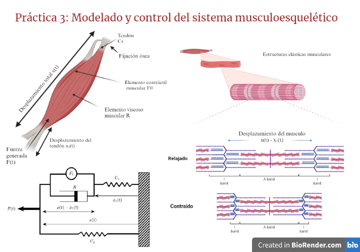
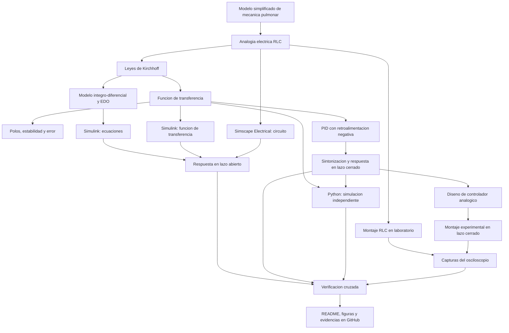

# Práctica 3 — Modelado y control del sistema musculoesquelético

Repositorio académico de la asignatura **Modelado de Sistemas Fisiológicos**, correspondiente al programa de **Ingeniería Biomédica** del Tecnológico Nacional de México / Instituto Tecnológico de Tijuana. Esta práctica integra modelado matemático, analogías electromecánicas, análisis temporal y de estabilidad, diseño de controladores, simulación computacional y verificación cruzada de resultados.

El caso de estudio representa el **sistema musculoesquelético** mediante un modelo mecánico viscoelástico simplificado, compuesto por un elemento contráctil, un amortiguador viscoso y dos elementos elásticos. Se busca reproducir y comparar la respuesta de un individuo sano (**control**) con un caso simulado de **atrofia muscular**, tanto en lazo abierto como en lazo cerrado, mediante una estrategia de control orientada a reducir las diferencias entre ambas respuestas.

**Docente:** Dr. Paul Antonio Valle Trujillo  
**Correo:** paul.valle@tectijuana.edu.mx  
**Departamento:** Ingeniería Eléctrica y Electrónica  
**Institución:** Tecnológico Nacional de México / Instituto Tecnológico de Tijuana  
**Asignatura:** Modelado de Sistemas Fisiológicos  
**Programa:** Ingeniería Biomédica  
**Estudiante:** Carolina Gamez Flores · 23212193 · l23212193@tectijuana.edu.mx

**Repositorio de la asignatura:** https://github.com/DrPaulValle/MSF-IBF1020  
**Sede:** Blvd. Alberto Limón Padilla s/n, Tijuana, C. P. 22454, B. C., México.

---

<a id="contenido"></a>
## Contenido

1. [Resumen](#resumen)
2. [Competencia y objetivos](#objetivos)
3. [Relación con el temario](#temario)
4. [Modelo físico y analogía eléctrica](#analogia)
5. [Formulación matemática](#modelo)
6. [Análisis temporal y de estabilidad](#analisis)
7. [Señales de entrada y condiciones de simulación](#senales)
8. [Implementación en MATLAB, Simulink y Simscape](#matlab)
9. [Control en lazo cerrado y sintonización PID](#pid)
10. [Reproducción en Python](#python)
11. [Controlador y experimentación in silico](#laboratorio)
12. [Resultados y verificación cruzada](#resultados)
13. [Flujo de trabajo](#flujo)
14. [Actividades del estudiante](#actividades)
15. [Estructura del repositorio](#estructura)
16. [Requisitos](#requisitos)
17. [Reproducibilidad y entregables](#reproducibilidad)
18. [Referencias](#referencias)

---

<a id="resumen"></a>
## Resumen

La práctica tiene como propósito **desarrollar un procedimiento de modelado, análisis, simulación y control** del sistema musculoesquelético mediante la experimentación *in silico*. El comportamiento mecánico se aproxima mediante un modelo viscoelástico compuesto por un elemento contráctil activo, un amortiguador viscoso de coeficiente $R$ y dos elementos elásticos caracterizados por las compliancias $C_p$ y $C_s$. Mediante la analogía fuerza-voltaje se construye un circuito eléctrico equivalente que permite formular las ecuaciones del sistema y obtener su función de transferencia aplicando el principio de superposición y la transformada de Laplace.

Se estudian el error en estado estacionario y la estabilidad de los modelos correspondientes a un **individuo sano (control)** y un **caso simulado de atrofia muscular**, representado mediante el incremento de la resistencia equivalente de $100\ \Omega$ a $10\ \mathrm{k}\Omega$. Posteriormente, se implementan las representaciones matemáticas y eléctricas en MATLAB/Simulink y Simscape Electrical para comparar sus respuestas ante una señal de entrada de tipo pulso. Se incorpora un sistema de retroalimentación negativa con un **controlador PI**, sintonizado mediante la herramienta Tune, para reducir el error entre la respuesta del caso y la referencia del individuo sano. Los resultados se reproducen mediante Python y se comparan con las simulaciones obtenidas en MATLAB.

Esta práctica corresponde a un ejercicio de **modelado y verificación computacional**. La estrategia de control desarrollada tiene fines exclusivamente académicos y de simulación, por lo que no constituye una intervención terapéutica para el tratamiento de la atrofia muscular.

**Palabras clave:** sistema musculoesquelético; modelo viscoelástico; analogía fuerza-voltaje; atrofia muscular; controlador PI; MATLAB; Simulink; Simscape Electrical; Python; simulación *in silico*.

[Volver al contenido](#contenido)

---

<a id="objetivos"></a>
## Competencia y objetivos

### Competencia a desarrollar

Modeliza sistemas fisiológicos mediante analogías entre sistemas físicos, ecuaciones diferenciales y funciones de transferencia para analizar su comportamiento dinámico y diseña estrategias de control mediante técnicas de control clásico. En particular, durante esta práctica se estudia un modelo mecánico simplificado del sistema musculoesquelético, se construye su circuito eléctrico equivalente mediante la analogía fuerza-voltaje, se compara la respuesta de un individuo sano (control) con un caso simulado de atrofia muscular (caso) y se diseña una estrategia de control *in silico* orientada a reducir las diferencias entre ambas respuestas.

### Objetivo general

Modelar y analizar el comportamiento dinámico del sistema musculoesquelético mediante su representación mecánica viscoelástica, la formulación matemática y la implementación de un circuito eléctrico equivalente, comparando las respuestas de un individuo sano y un caso simulado de atrofia muscular, así como diseñar y verificar un sistema de control con retroalimentación mediante MATLAB/Simulink, Simscape Electrical y Python.

### Objetivos específicos

- Identificar los elementos del modelo mecánico simplificado del sistema musculoesquelético y describir sus propiedades contráctiles, viscosas y elásticas.
- Construir el circuito eléctrico equivalente mediante la analogía fuerza-voltaje, considerando las correspondencias entre los elementos mecánicos y eléctricos.
- Formular las ecuaciones del sistema y obtener su función de transferencia mediante la transformada de Laplace y el principio de superposición.
- Determinar las funciones de transferencia del individuo sano (control) y del caso simulado de atrofia muscular (caso), considerando sus respectivos parámetros.
- Calcular el error en estado estacionario, determinar los polos y analizar la estabilidad de ambas condiciones.
- Implementar los modelos matemáticos, las funciones de transferencia y el circuito eléctrico equivalente mediante MATLAB/Simulink y Simscape Electrical.
- Comparar las respuestas en lazo abierto del control y del caso ante una señal de entrada tipo pulso.
- Diseñar un sistema de retroalimentación negativa y sintonizar un controlador mediante la herramienta Tune de Simulink para reducir el error entre ambas respuestas.
- Obtener las respuestas del control, caso y sistema controlado mediante un cuaderno computacional de MATLAB.
- Reproducir las funciones de transferencia y las respuestas del sistema mediante Python para verificar la consistencia de los resultados obtenidos.
- Elaborar un diagrama biológico que relacione los elementos del modelo con las estructuras fisiológicas del sistema musculoesquelético.
- Documentar el análisis matemático, los modelos computacionales, las simulaciones y los resultados en un repositorio de GitHub.

[Volver al contenido](#contenido)

---

<a id="temario"></a>
## Relación con el temario

La práctica integra contenidos de la asignatura **Modelado de Sistemas Fisiológicos (IBF-1020)** relacionados con el modelado matemático de sistemas fisiológicos, la representación mediante circuitos eléctricos equivalentes y el diseño de controladores clásicos.

| Área | Contenidos aplicados |
|---|---|
| Sistemas de control retroalimentados | Diagramas de bloques, sistemas en lazo abierto y cerrado, señales de referencia, error y respuesta temporal |
| Modelado matemático | Analogía fuerza-voltaje, formulación de ecuaciones, principio de superposición, transformada de Laplace y funciones de transferencia |
| Análisis de sistemas | Polos, estabilidad, comportamiento transitorio y error en estado estacionario |
| Controladores | Diseño del sistema de retroalimentación, sintonización de ganancias y análisis de la respuesta controlada |
| Simulación computacional | MATLAB, Simulink, Simscape Electrical y Python para la implementación y verificación de los modelos |

El enfoque combina los principios de la **Ingeniería de Control, la Electrónica Analógica, las Ciencias de la Computación y la Fisiología**, permitiendo establecer relaciones cuantitativas entre el comportamiento mecánico del sistema musculoesquelético y su representación mediante modelos matemáticos y circuitos eléctricos equivalentes.

[Volver al contenido](#contenido)

---

<a id="analogia"></a>
## Modelo físico y analogía eléctrica

El sistema musculoesquelético se aproxima mediante un modelo mecánico viscoelástico simplificado, en el cual la fuerza desarrollada por el elemento contráctil activo se transmite a través de componentes que representan las propiedades viscosas y elásticas de los tejidos musculares y tendinosos.

El modelo considera una fuerza activa $F_0(t)$, una fuerza transmitida $F(t)$, un amortiguador viscoso $R$ y dos elementos elásticos caracterizados por sus compliancias $C_p$ y $C_s$. La relación entre la fuerza del elemento contráctil y la fuerza aplicada al sistema se establece mediante:

$$
F_0(t)=\alpha F(t), \qquad 0<\alpha<1.
$$

El amortiguador $R$ representa la disipación viscosa del tejido, mientras que $C_p$ y $C_s$ representan, respectivamente, las propiedades elásticas del elemento paralelo y del elemento en serie. Estas propiedades se asocian de manera simplificada con la elasticidad del sarcolema, las estructuras musculares pasivas y los tendones.

El desplazamiento total del sistema se representa mediante $x(t)$, mientras que $x_1(t)$ corresponde al desplazamiento del elemento elástico en serie. Por lo tanto, la deformación relativa asociada al amortiguador está dada por:

$$
x(t)-x_1(t).
$$

La velocidad relativa correspondiente se expresa como:

$$
\frac{d}{dt}[x(t)-x_1(t)].
$$

### 1. Analogía fuerza-voltaje

Para facilitar el análisis matemático y la implementación computacional, se utiliza la analogía fuerza-voltaje, mediante la cual las variables y componentes mecánicos se representan por sus equivalentes eléctricos.

| Sistema mecánico | Sistema eléctrico equivalente |
|---|---|
| Fuerza $F(t)$ | Voltaje $V(t)$ |
| Velocidad $\frac{dx(t)}{dt}$ | Corriente $I(t)$ |
| Desplazamiento $x(t)$ | Carga eléctrica $q(t)$ |
| Amortiguador viscoso $R$ | Resistencia eléctrica $R$ |
| Compliancia mecánica | Capacitancia eléctrica $C$ |
| Masa | Inductancia eléctrica $L$ |

Una consecuencia importante de esta analogía es que las conexiones mecánicas y eléctricas no conservan necesariamente la misma topología. Los elementos mecánicos conectados en paralelo pueden representarse mediante componentes eléctricos en serie, mientras que los elementos mecánicos conectados en serie pueden representarse mediante componentes eléctricos en paralelo.

La ubicación de los nodos de referencia y la relación entre los desplazamientos permiten establecer correctamente la configuración del circuito equivalente.

### 2. Parámetros de la simulación

Para representar las condiciones del individuo sano (control) y el caso simulado de atrofia muscular (caso), se utilizan los siguientes parámetros:

| Parámetro | Control | Caso |
|---|---:|---:|
| Fuerza de entrada $F(t)$ | $1\ \mathrm{V}$ | $1\ \mathrm{V}$ |
| Coeficiente $\alpha$ | $0.25$ | $0.25$ |
| Compliancia en serie $C_s$ | $10\ \mu\mathrm{F}$ | $10\ \mu\mathrm{F}$ |
| Compliancia en paralelo $C_p$ | $100\ \mu\mathrm{F}$ | $100\ \mu\mathrm{F}$ |
| Resistencia $R$ | $100\ \Omega$ | $10\ \mathrm{k}\Omega$ |

Los valores corresponden a los parámetros eléctricos equivalentes utilizados durante la experimentación *in silico*. La principal diferencia entre ambas condiciones se establece mediante el incremento de la resistencia $R$, empleado para modificar la componente viscosa del modelo y generar una respuesta dinámica diferente.

En el caso simulado de atrofia muscular, la resistencia aumenta de $100\ \Omega$ a $10\ \mathrm{k}\Omega$, mientras que los valores de las compliancias y el coeficiente $\alpha$ permanecen constantes.

### 3. Interpretación fisiológica

El incremento del amortiguamiento viscoso modifica la velocidad de respuesta del sistema musculoesquelético ante una fuerza aplicada. En la simulación, el individuo sano presenta una respuesta más rápida, mientras que el caso de atrofia muscular presenta una evolución temporal más lenta debido al incremento de la resistencia equivalente.

Para el diseño del controlador, la respuesta del individuo sano se utiliza como referencia. La diferencia entre ambas respuestas permite establecer una señal de error que será utilizada posteriormente para construir el sistema de retroalimentación negativa.

El modelo constituye una representación simplificada del comportamiento viscoelástico muscular. Los parámetros eléctricos se utilizan para reproducir la dinámica del sistema y no representan mediciones clínicas directas de la atrofia muscular.

### 4. Representación biológica del sistema

El diagrama elaborado mediante BioRender relaciona los componentes del modelo mecánico con las estructuras fisiológicas del sistema musculoesquelético. Se identifican el elemento contráctil muscular, el componente viscoso, las estructuras elásticas, los tendones, los desplazamientos y la fuerza transmitida.



**Figura 1.** Representación biológica del sistema musculoesquelético y su relación con el modelo mecánico viscoelástico simplificado. Elaboración mediante BioRender.

[Volver al contenido](#contenido)

---


<a id="modelo"></a>
## Formulación matemática

### 1. Ecuaciones integro-diferenciales

Aplicando la ley de voltajes de Kirchhoff y suponiendo que la presión alveolar se representa mediante el voltaje del capacitor, se obtiene

$$
P_{ao}(t)=L\frac{dQ(t)}{dt}+RQ(t)+\frac{1}{C}\int Q(t)\,dt,
$$

$$
P_A(t)=\frac{1}{C}\int Q(t)\,dt.
$$

La representación utilizada para construir el diagrama de bloques puede escribirse como

$$
Q(t)=\frac{1}{R}\left[P_{ao}(t)-L\frac{dQ(t)}{dt}-\frac{1}{C}\int Q(t)\,dt\right],
$$

$$
P_A(t)=\frac{1}{C}\int Q(t)\,dt.
$$

### 2. Función de transferencia

Con condiciones iniciales nulas, al aplicar la transformada de Laplace se verifica que

$$
\boxed{G(s)=\frac{P_A(s)}{P_{ao}(s)}=\frac{1}{LCs^2+RCs+1}.}
$$

El denominador es de segundo grado debido a los **dos elementos independientes de almacenamiento de energía**, la inductancia y la capacitancia.

### 3. Representación mediante EDO de primer orden

Definiendo las variables de estado $x_1(t)=P_A(t)$ y $x_2(t)=Q(t)$, el modelo anterior se expresa como

$$
\begin{aligned}
\dot x_1(t)&=\frac{x_2(t)}{C},\\
\dot x_2(t)&=\frac{P_{ao}(t)-R x_2(t)-x_1(t)}{L},\\
y(t)&=x_1(t).
\end{aligned}
$$

[Volver al contenido](#contenido)

---

<a id="analisis"></a>
## Análisis temporal y de estabilidad

### 1. Error en estado estacionario

Para una entrada escalón unitario,

$$
P_{ao}(s)=\frac{1}{s},\qquad P_A(s)=G(s)\frac{1}{s}.
$$

Si se cumple la estabilidad requerida para aplicar el teorema del valor final,

$$
\lim_{t\to\infty}P_A(t)=\lim_{s\to0}sP_A(s)=G(0)=1.
$$

Así, el error entre la entrada y la salida para **esa entrada escalón en lazo abierto** es

$$
\boxed{e_{ss}=\lim_{s\to0}sP_{ao}(s)[1-G(s)]=0.}
$$

Este resultado no garantiza seguimiento sin error ante entradas que varían continuamente, como una rampa o una senoide.

### 2. Polos y estabilidad

Los polos del sistema satisfacen

$$
LCs^2+RCs+1=0,
$$

$$
\boxed{\lambda_{1,2}=\frac{-RC\pm\sqrt{(RC)^2-4LC}}{2LC}.}
$$

Se deben sustituir los valores proporcionados, ubicar los polos en el plano complejo, verificar sus partes reales y relacionarlos con el comportamiento transitorio. Para $R,L,C>0$, todos los coeficientes del denominador son positivos, por lo que el sistema de segundo orden considerado tiene polos con parte real negativa.

Con los valores del circuito de referencia el discriminante $(RC)^2-4LC$ es positivo; se espera una **respuesta sobreamortiguada**, con polos reales negativos. Dado que sus escalas temporales son muy distintas, la simulación de transitorios extremadamente rápidos puede depender del solver empleado.

### 3. Predicción previa

Antes de ejecutar las simulaciones, elaborar un **bosquejo cualitativo de la respuesta al escalón** a partir del orden, los polos, la estabilidad y el valor final. Conservar el bosquejo y compararlo con las respuestas computacionales.

#### Ejemplo mínimo de verificación en MATLAB

```matlab
R = 10e3;       % ohm
L = 1e-6;       % H
C = 220e-6;     % F

num = 1;
den = [L*C, R*C, 1];
G = tf(num,den);
polos = pole(G)
```

Este código es ilustrativo; no sustituye los archivos y procedimientos de referencia proporcionados con la práctica.

[Volver al contenido](#contenido)

---

<a id="senales"></a>
## Señales de entrada y condiciones de simulación

El intervalo nominal de simulación es $0\le t\le10\,\mathrm{s}$. Cuando la configuración numérica lo requiera, se establece un **paso máximo** de $\Delta t=10^{-3}\,\mathrm{s}$; este límite no garantiza por sí solo la resolución de todos los transitorios rápidos de la planta.

| Señal | Definición para la simulación | Propósito |
|---|---|---|
| Escalón | $u(t)=1$ para $t\ge0$ | Examinar respuesta transitoria y valor final |
| Pulso | Amplitud $1$, duración $1\,\mathrm{s}$ | Examinar la respuesta ante una perturbación de duración finita |
| Rampa | $u(t)=t/10$ | Examinar seguimiento de una entrada creciente |
| Senoide | $u(t)=\sin(\pi t/2)$ | Examinar respuesta a una excitación periódica |

La entrada sinusoidal tiene amplitud $1\,\mathrm{V}$, frecuencia $f=250\,\mathrm{mHz}=0.25\,\mathrm{Hz}$ y frecuencia angular $\omega=2\pi f=\pi/2\,\mathrm{rad/s}$.

Las cuatro señales se aplican a las diferentes representaciones matemáticas y computacionales, tanto en lazo abierto como en lazo cerrado cuando corresponde. En el laboratorio se utilizan **aproximaciones periódicas realizables**, cuyas configuraciones se presentan más adelante.

[Volver al contenido](#contenido)

---

<a id="matlab"></a>
## Implementación en MATLAB, Simulink y Simscape

Se reproducen tres representaciones equivalentes del sistema:

| Implementación | Descripción | Aspecto por verificar |
|---|---|---|
| Ecuaciones integro-diferenciales, Simulink | Bloques de suma, ganancias, derivación e integración | Consistencia con las leyes de Kirchhoff |
| Función de transferencia, Simulink | Bloque de planta con $G(s)=1/(LCs^2+RCs+1)$ | Respuesta entrada–salida de segundo orden |
| Circuito equivalente, Simscape Electrical | Componentes eléctricos $R$, $L$ y $C$ | Concordancia con las representaciones matemáticas |

### Ejecución desde el cuaderno MATLAB

El cuaderno computacional suministrado permite ejecutar el modelo de Simulink y recuperar en el *Workspace* las señales de:

1. **Entrada:** $P_{ao}(t)$.
2. **Salida de lazo abierto:** $P_A(t)$ sin controlador.
3. **Salida de lazo cerrado:** $P_A(t)$ con controlador PID.

El estudiante debe revisar la conexión entre el cuaderno y Simulink, la extracción de datos y la generación de las cuatro figuras de respuesta en formato PDF. Los archivos de simulación se deben configurar siguiendo el instructivo y los modelos de referencia disponibles.

[Volver al contenido](#contenido)

---

<a id="pid"></a>
## Control en lazo cerrado y sintonización PID

### 1. Retroalimentación negativa

La planta $G(s)$ se conecta a un controlador PID con retroalimentación negativa unitaria. La señal de error es

$$
e(t)=P_{ao}(t)-P_A(t).
$$

La ley de control ideal en el dominio temporal está dada por

$$
u(t)=k_Pe(t)+k_I\int_0^t e(\tau)\,d\tau+k_D\frac{de(t)}{dt},
$$

y en el dominio de Laplace, formalmente,

$$
K(s)=k_P+\frac{k_I}{s}+k_Ds.
$$

Para el caso ideal de retroalimentación negativa unitaria, la función de transferencia de lazo cerrado es

$$
T(s)=\frac{K(s)G(s)}{1+K(s)G(s)}.
$$

En una implementación real o mediante el bloque **PID Controller**, deben revisarse la configuración y cualquier filtrado de la acción derivativa.

### 2. Sintonización

Utilizar la opción **Tune** del bloque `PID Controller` de Simulink y registrar las ganancias $k_P$, $k_I$ y $k_D$ obtenidas. La respuesta al escalón de lazo cerrado debe satisfacer ambos requisitos:

$$
\boxed{t_s \leq 100\,\mathrm{ms}},
\qquad
\boxed{M_p \leq 0.10}
$$

Para una referencia unitaria, el límite de sobreimpulso corresponde a un pico no mayor de aproximadamente $1.1\,\mathrm{V}$. Conservar la evidencia de la respuesta empleada para verificar los criterios.

**No es obligatorio reproducir exactamente los valores numéricos de las ganancias de referencia:** pueden variar con la versión del software y el procedimiento de sintonización. Lo importante es demostrar cumplimiento de los requisitos y consistencia de los resultados.

### 3. Realización mediante componentes analógicos

El instructivo proporciona las relaciones nominales siguientes para el diseño basado en resistencias y capacitancias:

$$
k_P=\frac{R_r}{R_e},\qquad
k_I=\frac{1}{R_eC_r},\qquad
k_D=C_eR_r.
$$

Estas expresiones orientan el cálculo inicial y la elección de **valores comerciales** para el controlador con amplificadores operacionales.

> **Verificación necesaria del diseño analógico:** la expresión racional del PID transcrita en el instructivo, al dividirse algebraicamente, contiene en su término proporcional $C_e/C_r+R_r/R_e$, mientras que la relación nominal anterior identifica $k_P=R_r/R_e$. Antes de construir o reportar una equivalencia exacta, verificar la topología del circuito original y cuál es la ganancia proporcional efectiva. No se han supuesto valores de componentes o ganancias que no aparecen especificados en la práctica.

[Volver al contenido](#contenido)

---

<a id="python"></a>
## Reproducción en Python

El programa de referencia en Python, ejecutado mediante **Visual Studio Code**, permite comprobar los resultados con una segunda herramienta computacional. Se deben identificar y explicar sus apartados:

1. Definición del vector temporal.
2. Construcción de las cuatro señales de entrada.
3. Definición de la función de transferencia del circuito RLC.
4. Cálculo de los polos de la planta.
5. Definición del controlador con las ganancias sintonizadas en Simulink.
6. Construcción del sistema con retroalimentación negativa.
7. Simulación de la respuesta forzada.
8. Generación y almacenamiento de figuras.

Sustituir los valores de $k_P$, $k_I$ y $k_D$ obtenidos durante la sintonización. Comparar las respuestas de Python con las de MATLAB/Simulink **bajo las mismas entradas, condiciones iniciales y parámetros**.

El código Python de referencia es parte de los recursos entregados para la práctica; el instructivo no exige una librería concreta en su descripción, por lo que las dependencias deben verificarse directamente en los módulos importados por el archivo `.py` suministrado.

[Volver al contenido](#contenido)

---

<a id="laboratorio"></a>
## Controlador analógico y laboratorio

### Materiales y equipo

**Componentes:** resistor de $10\,\mathrm{k}\Omega$, inductor de $1\,\mu\mathrm{H}$, capacitor de $220\,\mu\mathrm{F}$, amplificadores operacionales, resistores y capacitores del controlador, protoboard y cables.

**Instrumentos:** generador de funciones, fuente de alimentación simétrica, osciloscopio, multímetro digital y memoria USB para resguardar capturas.

### Configuración del generador de funciones

Las señales experimentales se implementan con los siguientes ajustes indicados en el instructivo:

| Aproximación | Forma de onda | Frecuencia | Amplitud | Offset | Ajuste adicional |
|---|---|---:|---:|---:|---|
| Escalón | `Pulse` | $50\,\mathrm{mHz}$ | $1\,V_{pp}$ | $500\,\mathrm{mV_{DC}}$ | Duty cycle: $99\%$ |
| Pulso de $1\,\mathrm{s}$ | `Pulse` | $100\,\mathrm{mHz}$ | $1\,V_{pp}$ | $500\,\mathrm{mV_{DC}}$ | Duty cycle: $10\%$ |
| Rampa | `Ramp` | $100\,\mathrm{mHz}$ | $1\,V_{pp}$ | $500\,\mathrm{mV_{DC}}$ | Symmetry: $99\%$ |
| Sinusoidal | `Sine` | $250\,\mathrm{mHz}$ | $2\,V_{pp}$ | $0\,\mathrm{V_{DC}}$ | Sin parámetro adicional |

**Importante:** estos son ajustes para la **aproximación experimental periódica** de las entradas; no deben confundirse con las definiciones ideales empleadas para las simulaciones numéricas.

### 1. Planta RLC en lazo abierto

Montar el circuito equivalente sobre protoboard, aplicar las cuatro señales y utilizar el osciloscopio para registrar simultáneamente **entrada y salida**. Guardar una captura por cada señal. Identificar la ventana de observación utilizada y, cuando sea posible, anotar la escala temporal y de voltaje.

### 2. Controlador y planta en lazo cerrado

Reproducir el diseño del controlador analógico con los valores comerciales elegidos, conectarlo con el circuito RLC y alimentar los amplificadores operacionales mediante

$$
V_{CC}=+15\,\mathrm{V},\qquad V_{EE}=-15\,\mathrm{V}.
$$

Aplicar nuevamente las entradas y registrar las respuestas del sistema controlado. Antes de energizar el montaje, verificar polaridades, conexiones, valores nominales y límites eléctricos de los componentes.

### 3. Comparación con la simulación

Analizar posibles discrepancias asociadas con las tolerancias de $R$, $L$ y $C$; los valores comerciales del PID; la no idealidad de los amplificadores operacionales; las limitaciones del instrumental; las aproximaciones de forma de onda; las condiciones iniciales y las simplificaciones del modelo fisiológico.

[Volver al contenido](#contenido)

---

<a id="resultados"></a>
## Resultados y verificación cruzada

Las respuestas deben permitir contrastar **entrada, salida de lazo abierto y salida de lazo cerrado** para cada una de las cuatro señales. El instructivo establece una convención gráfica de referencia:

- **Amarillo:** entrada aplicada, $P_{ao}(t)$.
- **Azul:** salida de la planta en lazo abierto, $P_A(t)$.
- **Verde:** salida en lazo cerrado con PID.

### Archivos de resultados identificados en el instructivo

| Entrada | MATLAB/Simulink | Python | Laboratorio (osciloscopio) |
|---|---|---|---|
| Escalón | [`step_matlab.pdf`](step_matlab.pdf) | [`step_python.pdf`](step_python.pdf) | [`stepLC.pdf`](stepLC.pdf) |
| Pulso | [`impulse_matlab.pdf`](impulse_matlab.pdf) | [`impulse_python.pdf`](impulse_python.pdf) | [`impulseLC.pdf`](impulseLC.pdf) |
| Rampa | [`ramp_matlab.pdf`](ramp_matlab.pdf) | [`ramp_python.pdf`](ramp_python.pdf) | [`rampLC.pdf`](rampLC.pdf) |
| Sinusoidal | [`sinusoidal_matlab.pdf`](sinusoidal_matlab.pdf) | [`sinusoidal_python.pdf`](sinusoidal_python.pdf) | [`sinLC.pdf`](sinLC.pdf) |

**Diagrama del sistema físico y el controlador:** [`Multisim_Cerrado2.png`](Multisim_Cerrado2.png). La figura del instructivo fue elaborada originalmente con Multisim; las simulaciones actuales de componentes eléctricos se plantean en **Simscape Electrical**.

Los enlaces anteriores utilizan los **nombres de archivos citados por el documento de la práctica**. Funcionarán cuando esos archivos estén incluidos en la raíz del repositorio; si se organizan por carpetas, deberán ajustarse las rutas relativas del README. Los PDF se enlazan para su consulta, dado que GitHub no los presenta como imágenes incrustadas convencionales.

### Aspectos para discutir

- Coincidencia entre las representaciones por ecuaciones, función de transferencia y circuito físico simulado.
- Diferencias entre lazo abierto y lazo cerrado y efecto del PID sobre el seguimiento.
- Cumplimiento de $t_s\le100\,\mathrm{ms}$ y $M_p\le10\%$.
- Consistencia entre las figuras de MATLAB y Python.
- Diferencias entre resultados computacionales y señales medidas en el osciloscopio.
- Fuentes de incertidumbre y limitaciones de la analogía fisiológica.

**Resultados del estudiante:** agregar en la versión final del repositorio las ganancias sintonizadas, la evidencia de cumplimiento, las capturas y un comentario interpretativo propio sobre cada familia de respuestas. No se incluyen valores experimentales ni ganancias PID ficticias en esta plantilla.

[Volver al contenido](#contenido)

---

<a id="flujo"></a>
## Flujo de trabajo



El procedimiento integra la formulación analítica, la experimentación *in silico* y la comprobación con instrumentos de laboratorio.

[Volver al contenido](#contenido)

---

<a id="actividades"></a>
## Actividades del estudiante

La práctica sigue una secuencia de **reproducción, verificación y documentación**, no un proceso de identificación de parámetros a partir de datos experimentales.

### Etapa 1. Formulación y análisis

- [ ] Identificar en el circuito $P_{ao}(t)$, $P_A(t)$, $Q(t)$, $R$, $L$ y $C$.
- [ ] Derivar las ecuaciones integro-diferenciales.
- [ ] Comprobar la función de transferencia.
- [ ] Expresar el modelo como sistema de EDO lineales de primer orden.
- [ ] Calcular el error en estado estacionario ante escalón unitario.
- [ ] Calcular y representar los polos de la planta.
- [ ] Elaborar el bosquejo previo de respuesta al escalón.

### Etapa 2. Simulación de la planta

- [ ] Reproducir el modelo por ecuaciones en Simulink.
- [ ] Reproducir la función de transferencia en Simulink.
- [ ] Reproducir el circuito equivalente en Simscape Electrical.
- [ ] Comparar las respuestas a escalón, pulso, rampa y senoide.

### Etapa 3. Diseño y comprobación del controlador

- [ ] Implementar la retroalimentación negativa con PID.
- [ ] Sintonizar y registrar $k_P$, $k_I$ y $k_D$.
- [ ] Verificar el tiempo de establecimiento y el sobreimpulso.
- [ ] Reproducir las respuestas desde MATLAB y guardarlas en PDF.
- [ ] Reproducir las respuestas en Python con las mismas ganancias.
- [ ] Verificar las relaciones algebraicas del controlador analógico.
- [ ] Seleccionar componentes comerciales y comparar el controlador físico simulado con el ideal.

### Etapa 4. Comprobación experimental y documentación

- [ ] Construir y medir el circuito RLC en lazo abierto.
- [ ] Construir el circuito controlado en lazo cerrado.
- [ ] Registrar las cuatro entradas y sus respectivas respuestas.
- [ ] Comparar resultados de MATLAB, Python y laboratorio.
- [ ] Incorporar figuras, capturas y fotografías del montaje.
- [ ] Redactar una interpretación de los resultados y sus diferencias.
- [ ] Publicar los archivos y un `CITATION.cff` correctamente identificados.

[Volver al contenido](#contenido)

---

<a id="estructura"></a>
## Estructura del repositorio

Una organización **sugerida** para la entrega, compatible con los tipos de archivos solicitados, es:

```text
.
├── README.md                      # Reporte y guía de reproducción
├── CITATION.cff                   # Datos de citación del repositorio
├── Apellido_NoControl.mlx         # Cuaderno MATLAB del estudiante
├── Apellido_NoControl.pdf         # Exportación del cuaderno
├── modelo_respiratorio.slx        # Modelo Simulink/Simscape
├── modelo_respiratorio.py         # Implementación Python
├── pulmonar.pdf                  # Diagrama base del circuito (instructivo)
├── Multisim_Cerrado2.png         # Diagrama de referencia del controlador
├── controlador_pid.png           # Captura de sintonización (nombre sugerido)
├── step_matlab.pdf
├── impulse_matlab.pdf
├── ramp_matlab.pdf
├── sinusoidal_matlab.pdf
├── step_python.pdf
├── impulse_python.pdf
├── ramp_python.pdf
├── sinusoidal_python.pdf
├── stepLC.pdf
├── impulseLC.pdf
├── rampLC.pdf
├── sinLC.pdf
└── evidencias/                   # Fotografías y capturas adicionales
```

**Criterio de nombres:** los archivos de resultados y diagramas conservan las denominaciones citadas en el instructivo LaTeX. Los nombres de cuaderno, modelo, script y captura del PID son **propuestas organizativas**, ya que sus nombres reales no aparecen especificados en los archivos aportados. Si se utilizan otros nombres o subcarpetas, actualizar las rutas del README y no eliminar evidencias requeridas.

[Volver al contenido](#contenido)

---

<a id="requisitos"></a>
## Requisitos

### Software

- **MATLAB** y **Simulink**, con el modelo y el cuaderno de referencia.
- **Simscape Electrical**, para construir el circuito de componentes eléctricos.
- Herramientas de Simulink para diseño y sintonización del bloque **PID Controller**.
- **Python** y **Visual Studio Code** para ejecutar el programa suministrado.
- Las bibliotecas Python que importe efectivamente el código de referencia.
- **Git y GitHub** para organizar y presentar el repositorio de la práctica.

Para el ejemplo opcional de MATLAB de esta guía que utiliza `tf` y `pole`, es necesario disponer de las funciones correspondientes de **Control System Toolbox**. Las versiones mínimas del software no se especifican en el instructivo.

### Recursos de laboratorio

Circuito RLC y componentes del PID, amplificadores operacionales, protoboard, alimentación simétrica, generador de funciones, osciloscopio, multímetro, cables y medio de almacenamiento para las capturas.

[Volver al contenido](#contenido)

---

<a id="reproducibilidad"></a>
## Reproducibilidad y entregables

### Secuencia de reproducción

1. Consultar el [repositorio general de la asignatura](https://github.com/DrPaulValle/MSF-IBF1020) y descargar los archivos proporcionados para la práctica.
2. Verificar la topología del circuito, los valores de $R$, $L$, $C$ y las condiciones iniciales.
3. Derivar el modelo y completar el análisis de polos y error en estado estacionario.
4. Ejecutar los modelos de Simulink y Simscape con las cuatro entradas definidas.
5. Sintonizar el PID y registrar las ganancias y la evidencia de los criterios de diseño.
6. Ejecutar el cuaderno MATLAB y exportar las cuatro respuestas.
7. Sustituir las ganancias en Python, reproducir las señales y exportar las cuatro figuras.
8. Verificar la implementación del PID mediante componentes y realizar los montajes experimentales en lazo abierto y cerrado.
9. Capturar las respuestas del osciloscopio para las cuatro señales.
10. Comparar resultados, explicar diferencias y completar este README con las evidencias propias.
11. Publicar el repositorio con sus fuentes y `CITATION.cff`.

### Resultados mínimos esperados

| Entregable | Evidencia solicitada |
|---|---|
| Formulación matemática | Ecuaciones, función de transferencia y modelo de primer orden |
| Análisis del sistema | Cálculo de polos, estabilidad, error y bosquejo de respuesta |
| Simulaciones | Modelo `.slx` y respuestas en lazo abierto y cerrado |
| Sintonización | Ganancias PID, figura de respuesta y verificación de $t_s$ y $M_p$ |
| MATLAB | Cuaderno `.mlx`, exportación `.pdf` y cuatro figuras |
| Python | Código `.py` y cuatro figuras |
| Controlador analógico | Cálculo de componentes, diseño y comparación con el PID ideal |
| Laboratorio | Fotografías del montaje y cuatro resultados de osciloscopio |
| Documentación | `README.md`, `CITATION.cff` e interpretación de los resultados |

### Criterios de presentación académica

En el README final debe distinguirse entre **resultados de referencia reproducidos**, **mediciones experimentales propias** y **modificaciones realizadas por el estudiante**. La ejecución de scripts y la generación de figuras, por sí solas, no sustituyen la discusión del comportamiento fisiológico, matemático y eléctrico del sistema.

[Volver al contenido](#contenido)

---

<a id="referencias"></a>
## Referencias

[1] M. C. Khoo, *Physiological Control Systems: Analysis, Simulation, and Estimation*, 2nd ed., IEEE Press, 2018, sección 4, p. 93.

[2] F. C. Hoppensteadt y C. S. Peskin, *Modeling and Simulation in Medicine and the Life Sciences*, Springer.

[3] J. E. Hall, *Guyton and Hall Textbook of Medical Physiology*, 14th ed., Elsevier, 2021.

[4] K. Ogata, *Ingeniería de Control Moderna*, 5.ª ed., Pearson Educación, 2010.

[5] N. S. Nise, *Control Systems Engineering*, 8th ed., John Wiley & Sons, 2020.

[6] P. A. Valle, *Syllabus para Modelado de Sistemas Fisiológicos*, Tecnológico Nacional de México / Instituto Tecnológico de Tijuana, Tijuana, B. C., México, 2026. Disponible en: https://biomath.xyz/course/

[7] Tecnológico Nacional de México, *Programa de estudio de la asignatura Modelado de Sistemas Fisiológicos, IBF-1020*.

---

## Uso académico

Este repositorio se utiliza como evidencia de una práctica introductoria de **Modelado de Sistemas Fisiológicos**. El procedimiento se fundamenta en materiales y resultados de referencia proporcionados por la asignatura. Su finalidad es desarrollar habilidades de interpretación, reproducción computacional, verificación experimental y documentación técnica; cualquier cambio de parámetros, estructura del controlador o procedimiento debe identificarse y justificarse.

